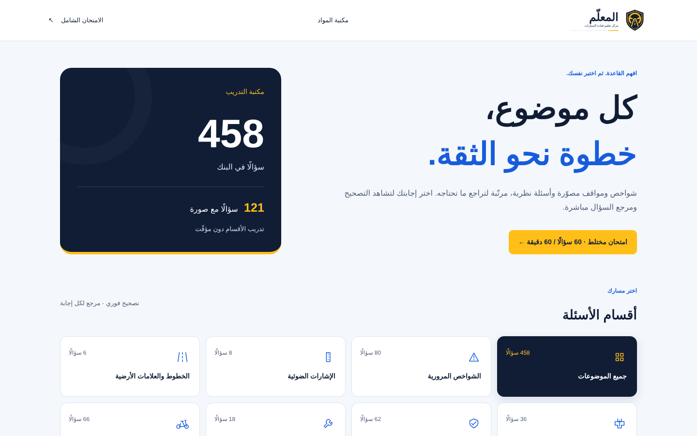
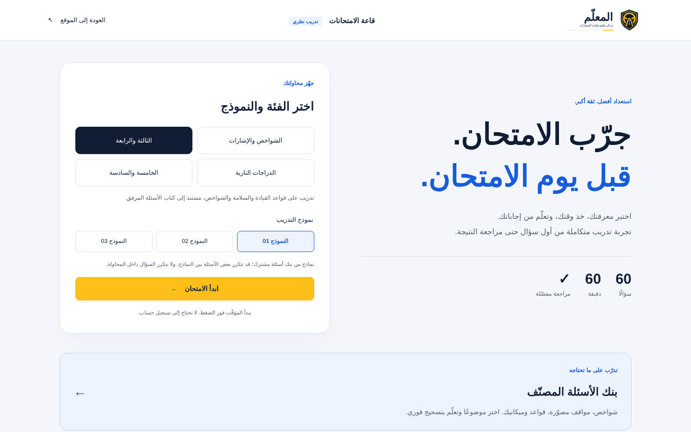
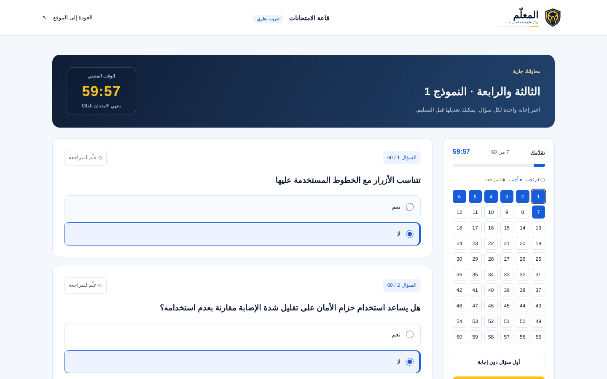
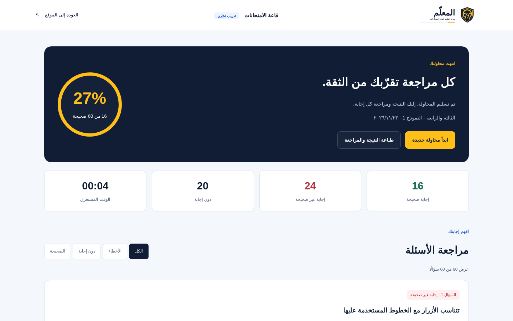
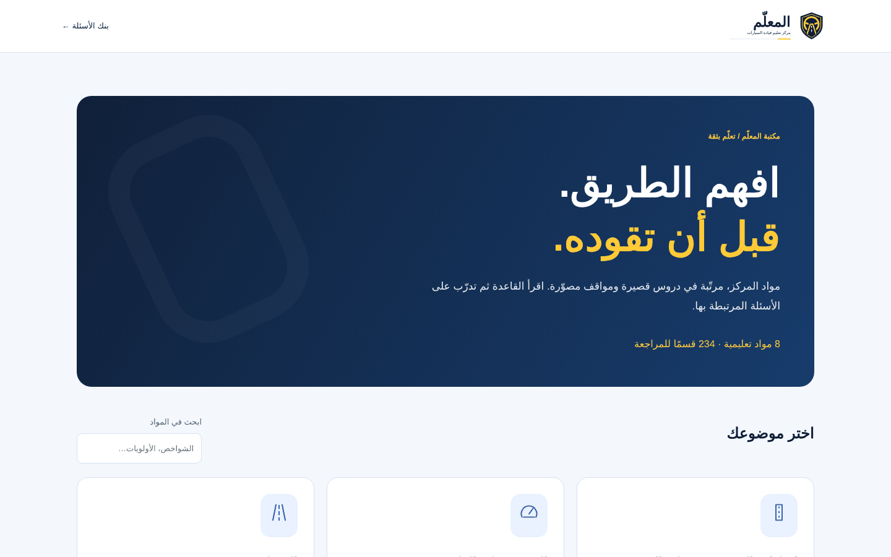
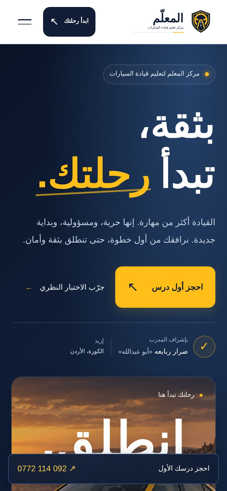
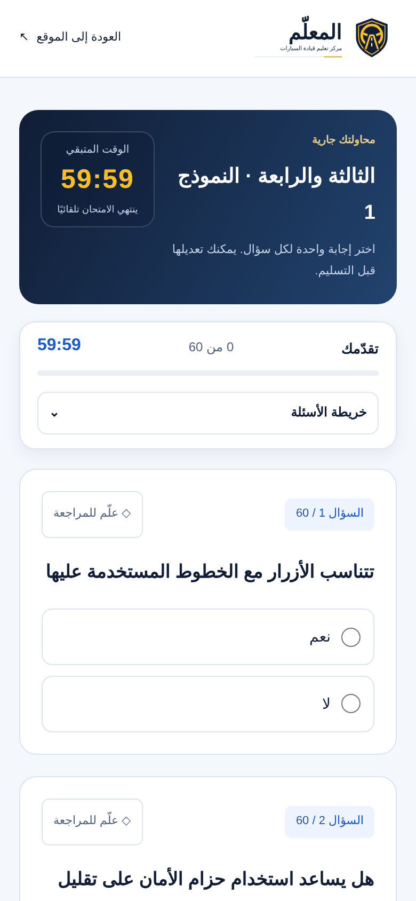

<div align="center">


# مركز المعلّم لتعليم قيادة السيارات

**موقع عربي متكامل لمركز تعليم قيادة في الأردن: تعريف بالمركز، حجز الدروس، بنك أسئلة نظرية، قاعة امتحانات بمؤقّت، ومكتبة مواد تعليمية.**

[](https://almoallem.centerjo.workers.dev/)


</div>

---

## لمحة

موقع ثابت (Static) باتجاه RTL، متجاوب بالكامل من شاشة 320 بكسل حتى الشاشات الكبيرة، مبني بـ HTML وCSS وJavaScript دون أي إطار عمل أو خادم خلفي، ومنشور على Cloudflare Workers Static Assets.

| | |
|---|---|
| **بنك الأسئلة** | 458 سؤالًا فريدًا، منها 121 سؤالًا مع صورة |
| **قاعة الامتحانات** | 12 نموذجًا · 60 سؤالًا · 60 دقيقة · تسليم تلقائي |
| **مكتبة المواد** | 8 مواد تعليمية · 234 قسمًا مراجعًا |
| **الفئات** | السيارات · الشواخص والإشارات · الدراجات النارية · المركبات الثقيلة |

## لقطات من الموقع

### الصفحة الرئيسية


### بنك الأسئلة والتدريب


### قاعة الامتحانات
| اختيار الفئة والنموذج | أثناء الامتحان |
|---|---|
|  |  |

### النتيجة والمراجعة


### مكتبة المواد التعليمية


### على الهاتف
<p align="center">
  
  &nbsp;&nbsp;
  
</p>

## المزايا

- **صفحة رئيسية تعريفية**: عن المركز، رحلة التعلّم، الحجز بالاتصال أو واتساب، وموقع المركز على خرائط Google.
- **قاعة امتحانات واقعية**: مؤقّت يستمر حتى عند إغلاق الصفحة، خريطة أسئلة، تعليم للمراجعة، استكمال المحاولة بعد التحديث، مزامنة بين التبويبات، ونتيجة قابلة للطباعة.
- **تدريب حسب الموضوع**: 13 موضوعًا، بحث عربي، تصفية حسب الفئة والصور، تصحيح فوري مع مرجع كل إجابة، وتكبير الصور.
- **مكتبة مواد**: دروس قصيرة مستخرجة من العروض التعليمية، مع حفظ التقدّم وتدريب مرتبط بكل مادة.
- **خصوصية كاملة**: لا حسابات ولا قاعدة بيانات؛ المحاولات تُحفظ محليًا في متصفح الطالب.
- **وصولية وأداء**: دعم قارئات الشاشة، مساحات لمس مناسبة، وبدون أي اعتماد على مكتبات خارجية في وقت التشغيل.

## التقنيات المستخدمة

| المجال | التقنية |
|---|---|
| الواجهة | HTML5 · CSS3 (Grid/Flexbox, Custom Properties) · Vanilla JavaScript |
| الخطوط والرموز | IBM Plex Sans Arabic · أيقونات SVG مضمّنة |
| الحفظ المحلي | `localStorage` مع مزامنة بين التبويبات |
| البناء والتشغيل المحلي | Node.js 22 (سكربتات `build` و`serve` بدون تبعيات) |
| الاختبارات | Playwright (11 مقاس شاشة، محاكاة لمس، اختبارات منطق `node:test`) |
| خط إنتاج المحتوى | Python · PyMuPDF لاستخراج الأسئلة والصور من الكتب والعروض |
| النشر | Cloudflare Workers Static Assets · Wrangler |

## هيكل المشروع

```
├── public/            ملفات الموقع (HTML, CSS, JS, الصور، بيانات JSON)
│   ├── index.html     الصفحة الرئيسية
│   ├── exam.html      قاعة الامتحانات
│   ├── practice.html  بنك الأسئلة والتدريب
│   ├── materials.html مكتبة المواد
│   ├── sources.html   المصادر والمراجع
│   ├── assets/        الشعار والصور وصور الأسئلة والمواد
│   └── data/          question-bank.json و materials.json
├── scripts/           البناء، الخادم المحلي، الاختبارات، وتوليد البنك
├── content/           الكتب والمصادر وسجلات مراجعة الأسئلة
├── docs/screenshots/  لقطات الشاشة في هذا الملف
├── package.json
└── wrangler.jsonc     إعداد النشر على Cloudflare
```

## التشغيل محليًا

يتطلب Node.js 22 أو أحدث.

```sh
npm install
npm run dev
```

ثم افتح http://127.0.0.1:4173

## الاختبارات

```sh
npm run test            # فحص الصفحة الرئيسية على 11 مقاس شاشة
npm run test:exam       # منطق الامتحان + قاعة الامتحان في المتصفح
npm run test:practice   # صفحة التدريب
npm run test:materials  # مكتبة المواد
npm run test:return     # الخروج من الامتحان والعودة إليه
```

## البناء والنشر على Cloudflare

```sh
npm run build
npx wrangler login
npm run deploy
```

إعداد Workers Static Assets جاهز في `wrangler.jsonc`. للنشر عبر Git في Cloudflare Workers: أمر البناء `npm run build` وأمر النشر `npx wrangler deploy`. ولإنشاء ZIP جاهز للرفع اليدوي من Windows استخدم `npm run package`.

المصدر الرسمي: https://developers.cloudflare.com/workers/static-assets/

---

# التوثيق التفصيلي

## تعديل المحتوى

- المحتوى وروابط الاختبارات والتواصل: `public/index.html`.
- بنية التصميم وأحجام الشاشات: `public/styles.css`. الهوية اللونية الحالية والخطوط والبطاقات: `public/theme.css` (يُحمّل بعد الأنماط الأساسية).
- تنسيق بطاقات الاختبارات: `public/exams.css`. رموز المركبات والإشارات SVG موجودة مباشرة في `public/index.html` لتظهر دون الاعتماد على JavaScript.
- التصفية والقائمة وحركات التمرير: `public/app.js`.
- الصور: `public/assets/`. صور المركز الأصلية هي `fleet.png` و`center.png`؛ أزيلت نسختاهما المتطابقتان من جذر المشروع.
- `hero.png` صورة تعبيرية مولدة خصيصًا للموقع، وليست توثيقًا لسيارات المركز. الصور الأخرى مقدمة من صاحب المركز.
- الخط العربي يُحمّل من Google Fonts مع خطوط بديلة عند عدم الاتصال.

الاختبارات داخل الموقع في `exam.html`، والحجز يتم بالاتصال أو واتساب. محاولة التدريب الأخيرة تُحفظ محليًا في متصفح الطالب؛ لا توجد قاعدة بيانات أو لوحة مدرس أو إرسال للنتائج إلى خادم. روابط خرائط Google تشير إلى الموقع الذي قدمه صاحب المركز. الهاتف المعتمد هو 0772114092، وليس الرقم القديم الظاهر ضمن صورة الواجهة.

## نظام الامتحانات

ترتيب المشروع: `public/` لملفات الموقع، `scripts/` للبناء والفحص، و`content/` للكتب ومصادر الأسئلة. مجلد `dist/` ناتج البناء، وملف `al-moallem-cloudflare.zip` هو النسخة الجاهزة للرفع. `node_modules/` و`.tools/` تبعيات التطوير واستخراج الكتب، وليسا ملفات مكررة. يمكن إعادة توليد `artifacts/` عند تشغيل الفحوص؛ لا توجد مصادر أصلية محفوظة فيه.

- 60 سؤالًا، 60 دقيقة، تسليم تلقائي بانتهاء الوقت، مع فصل الإجابات الصحيحة والخاطئة وغير المجابة.
- قائمة كاملة قابلة للتمرير، خريطة للأسئلة، تعليم للمراجعة، استكمال بعد تحديث الصفحة، ونتيجة قابلة للطباعة.
- ثلاثة نماذج لكل من الشواخص والسيارات والدراجة والتدريب التخصصي الثقيل (12 نموذجًا). كل نموذج عينة ثابتة مختلفة من البنك نفسه، دون تكرار داخل النموذج، وقد تتداخل النماذج.
- البنك الحالي: 458 سؤال فريد، منها 121 سؤالًا مع صورة. السيارات 212، الشواخص 84، الدراجة 66، والثقيلة 293. الفئات متداخلة؛ لا تُجمع أعدادها. أضافت مراجعة العروض 31 سؤالًا جديدًا ودمجت 17 سؤالًا متكررًا في البنك مع حفظ المراجع البديلة.
- **الثقيلة مفعّلة كتدريب تخصصي**: كل نموذج 45 سؤالًا تخصصيًا و15 شواخص وإشارات. ليست نسخة مطابقة للنموذجين الأصليين في Google Forms ولا بنك الترخيص الرسمي. حُفظت الصور الأصلية وسجل مراجعة المواضع الـ120: 69 موضعًا بمرجع مستقل، و48 بصياغة مصححة، و3 مدمجة بسؤال قائم. هذه أعداد مواضع تشمل تكرارات الأصل وليست أسئلة إضافية. عولجت الأسئلة الـ64 المتبقية بالمراجعة أو إعادة الصياغة أو الدمج؛ سؤالا مواصفات ملصقات المواد الخطرة استُبدلا بسؤالين موثقين عن اشتراطاتها. لم تتوفر مفاتيح Google Forms الأصلية. تفاصيل المصادر في `content/README.md` و`public/sources.html`.
- التوقيت يستمر عند إغلاق الصفحة. عند العودة بعد انتهاء الساعة تظهر النتيجة بإجاباتها المحفوظة. الحفظ خاص بالمتصفح والجهاز؛ محو بيانات المتصفح يحذف المحاولة.
- النظام للتدريب الذاتي وليس لإجراء امتحان مراقب: مفاتيح الإجابات والتوقيت في المتصفح، ويمكن لمستخدم تقني تعديلها. لم يُطلب نظام شهادات أو مراقبة أو مصادقة.
- الاختبارات الوظيفية: `npm run test:exam`. تشمل محاكاة مرور ساعة، التصحيح، الاستعادة، المراجعة، التزامن بين التبويبات، وفحص الهاتف والكمبيوتر.
- صفحة `practice.html`: 13 موضوعًا، بحث عربي، تصفية حسب الفئة والصور، تصحيح فوري، تكبير الصور وترقيم صفحات. إجابات التدريب تبقى أثناء التنقل داخل الصفحة وتُصفّر عند إعادة تحميلها؛ حفظ المحاولة المؤقتة يخص صفحة الامتحان.
- نماذج السيارات تسحب من جميع الموضوعات المتاحة ثم تخلط ترتيب الأسئلة. هذا توزيع تدريبي وليس توزيعًا رسميًا.
- نجحت اختبارات المتصفح `npm run test:exam` و`npm run test:practice`، ومنها الثقيلة، التصحيح وروابط المراجع والرسومات ومقاسات 320 و390 و768 و1440. نجحت اختبارات المنطق العشرة. تعطل الموافقة السابق على المتصفح انتهى وأُجري الفحص فعليًا.
- تفاصيل المصادر: `content/source-review.md`. الأسئلة القديمة من كتب المستخدم، والثقيلة صياغة تدريبية من مراجع فنية رسمية متاحة لإعادة الاستخدام وفق OGL، مع تعريف الفئات من إدارة الترخيص الأردنية. لا تنقل حدود الأوزان أو القوانين البريطانية إلى الأردن.
- إعادة توليد الرسومات: `python -X utf8 scripts/build-heavy-diagrams.py`. نصوص الثقيلة في `scripts/heavy-questions.txt`، ومراجعها في `content/heavy-sources.json`. لتحديث البنك شغّل `python -X utf8 scripts/prepare-exam-bank.py` ثم `npm run package`.

## التحقق

```sh
npm run test
```

يفحص الاختبار 11 مقاسًا بين الكمبيوتر والأجهزة اللوحية والهواتف، بما فيها الوضع الأفقي وأصغر عرض 320 بكسل. يتحقق من عدم تجاوز المحتوى أو قصّه، ومساحات اللمس، والتصفية، والقائمة، والأسئلة الشائعة، والصور، ورابط الموقع، وأخطاء JavaScript وحركات التمرير. يتحقق أيضًا من بقاء نهاية الصفحة فوق زر الاتصال الثابت. تُحفظ لقطات الشاشة في `artifacts/`.

الاختبارات تستخدم محاكاة شاشة ولمس عبر Microsoft Edge المثبت على Windows، وليست اختبارًا على جهاز iPhone أو Android فعلي. يمكن ضبط `BROWSER_CHANNEL=chrome` لاستخدام Chrome.

## مراجعة النموذجين الأصليين للثقيلة

افتح `content/review-heavy.html` مباشرة في المتصفح. يحتوي 120 صورة محلية مع النص والخيارات؛ يمكن تصفية الأسئلة المتبقية، وتسجيل إجابة المدرب ومرجعها وتنزيل ملف JSON. هذه أداة تحرير محلية لا تدخل حزمة Cloudflare، ولا تنشر إجابات المدرب تلقائيًا. لا تعتبر القيم المحددة مسبقًا مفتاحًا رسميًا للنموذج؛ هي نتائج تحقق مستقل حيث توفر المرجع.

- أصل الصور: `content/sources/heavy-originals/`.
- سجل الأسئلة والمكرر وحالة كل إجابة: `content/heavy-original-review.json`.
- الإجابات المراجعة ومراجعها: `content/heavy-original-answers.txt`.
- إعادة توليد ملف المراجعة بعد البنك: `python -X utf8 scripts/build-heavy-review.py`.
- فحص العرض والتصحيح وأداة المراجعة: `node scripts/verify-heavy-originals.mjs`.

## مكتبة المواد التعليمية

أضيفت ثماني مواد من ملفات PowerPoint، تضم 234 قسمًا مراجعًا من أصل 255 شريحة. تدعم القراءة وتكبير الصور وحفظ التقدم والتدريب المرتبط. تفاصيل المراجعة والاستبعاد وإعادة التوليد في content/presentations/README.md. فحص المكتبة: npm run test:materials.

## تنظيف المشروع — 26 سبتمبر 2026

حُذفت لقطات الفحص المؤقتة وكاش Python وصور الأسئلة غير المستخدمة ونسخ الهوية الزائدة. بقيت الكتب والعروض الأصلية وسجلات مراجعة الإجابات وأدوات البناء؛ يحتاج توليد المواد إلى content/presentations/rendered، ويحتاج استخراج الكتب إلى .tools/pymupdf. مجلد node_modules لتشغيل أدوات التطوير والاختبارات. dist ناتج البناء وal-moallem-cloudflare.zip حزمة الرفع فقط.

صور الأسئلة المستبعدة من البنك لا تبقى ضمن public. لإعادة تقييم سؤال مستبعد ذي صورة، أعد تشغيل scripts/extract-question-bank.py من الكتب الأصلية أولًا. استخراج رسومات العروض يقتصر الآن على الرسومات المطلوبة في الأسئلة.

## مغادرة الاختبار والعودة — 26 سبتمبر 2026

تظهر بطاقة الاستكمال في أعلى الصفحة الرئيسية وداخل قسم الاختبارات، وتعرض الفئة والنموذج والإجابات والوقت المتبقي. رابطها يفتح المحاولة مباشرة. في قاعة الامتحان تظهر المحاولة فوق خيارات البدء مع تحديث الوقت. يستمر الموعد النهائي أثناء المغادرة، وعند العودة بعد انقضائه تُعرض النتيجة بالإجابات المحفوظة. تتم مزامنة التسليم والاستبدال وحذف المحاولة بين التبويبات؛ لا تعيد العودة أو تحديث الصفحة الساعة.

الحفظ محلي في المتصفح نفسه وعلى النطاق نفسه، ولا ينتقل بين الأجهزة أو من localhost إلى النطاق المنشور. بيانات محاولة لا تتوافق مع بنك محدث لا تُصحح بمفتاح مختلف، وتظهر رسالة لبدء محاولة جديدة. الفحص: npm run test:return (الخروج، إغلاق التبويب، العودة، الرجوع والتقدم، انتهاء الوقت، التزامن، البيانات غير الصالحة وأربعة مقاسات).

## حذف ملفات PowerPoint الأصلية

حُذفت ملفات PPTX الثمانية من جذر المشروع بطلب المستخدم. المواد المنشورة والصور المستخرجة وسجلات المراجعة باقية، ولا يتأثر تشغيل الموقع أو حزمة الرفع. إعادة استخراج العروض الأصلية أو رسم شرائحها من PowerPoint تتطلب توفير ملفات PPTX مجددًا؛ لا تشغّل خطوات الاستخراج الأصلية دونها.

